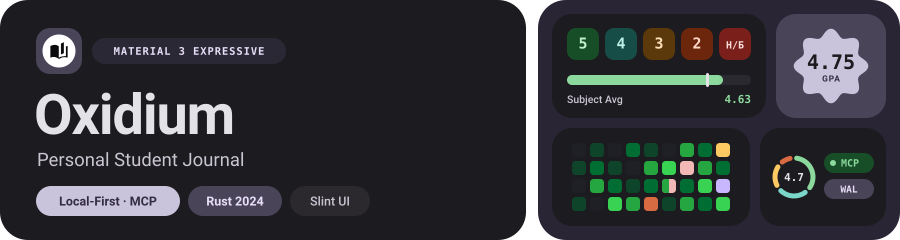
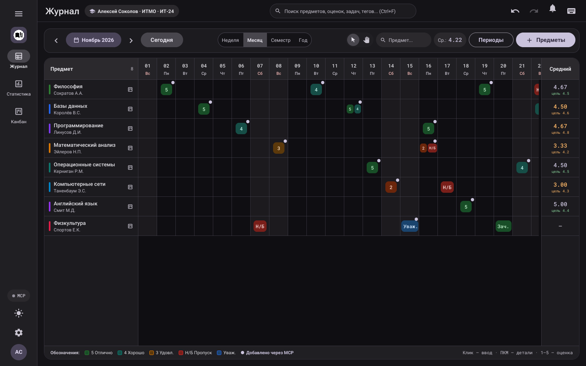
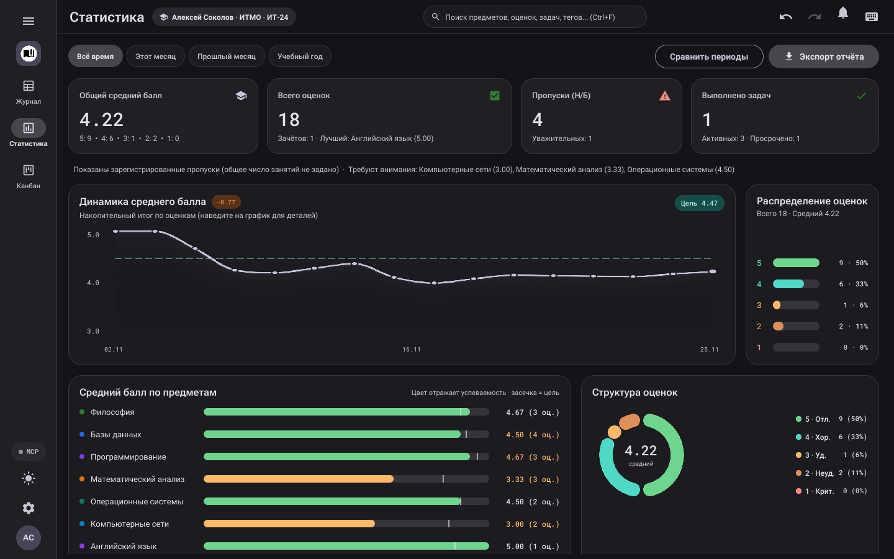
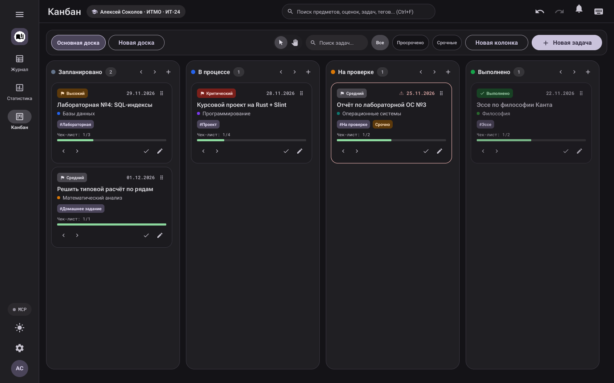
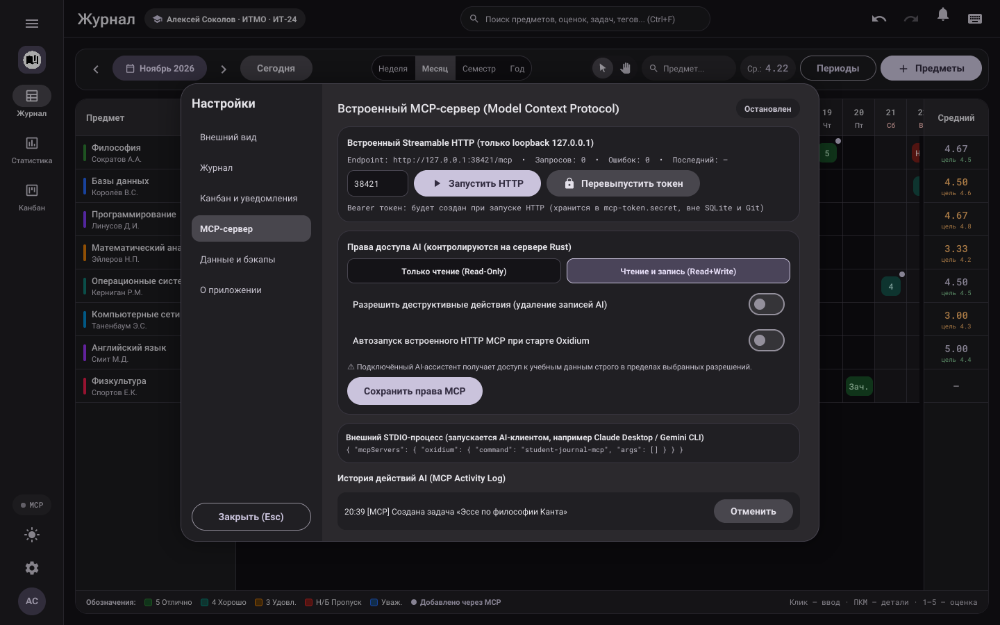
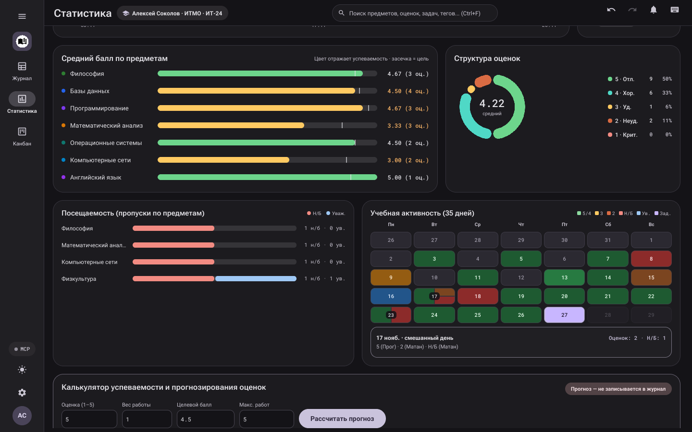
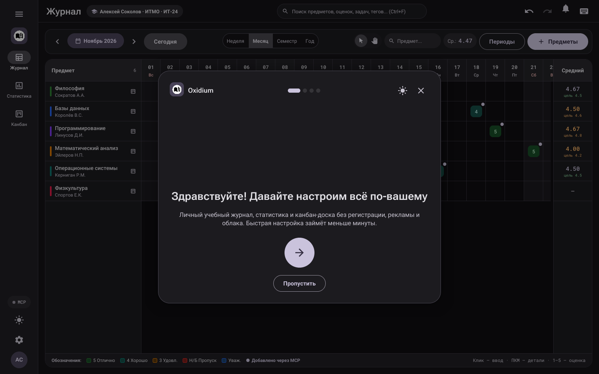
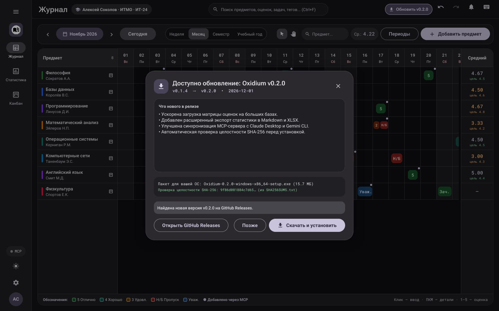

<p align="center">
  <picture>
    <source media="(prefers-color-scheme: dark)" srcset="docs/assets/banner-en-dark.svg">
    <source media="(prefers-color-scheme: light)" srcset="docs/assets/banner-en-light.svg">
    
  </picture>
</p>

<p align="center">
  <sub><code>RUST · SLINT M3 EXPRESSIVE · SQLITE · MCP</code></sub><br>
  <sub><a href="README.md">Русский</a> · <b>English</b></sub>
</p>

<p align="center">
  <b>Your personal next-gen desktop student journal.</b><br>
  Grades, analytics, Kanban tasks, and AI assistant integration via MCP — fast, local, and browser-free.
</p>

<p align="center">
  <a href="https://github.com/cryals/Oxidium/releases/latest">
    <picture>
      <source media="(prefers-color-scheme: dark)" srcset="docs/assets/badges/cta-en-download-dark.svg">
      <source media="(prefers-color-scheme: light)" srcset="docs/assets/badges/cta-en-download-light.svg">
      
    </picture>
  </a>
  <a href="docs/mcp/QUICKSTART.md">
    <picture>
      <source media="(prefers-color-scheme: dark)" srcset="docs/assets/badges/cta-en-mcp-dark.svg">
      <source media="(prefers-color-scheme: light)" srcset="docs/assets/badges/cta-en-mcp-light.svg">
      
    </picture>
  </a>
  <a href="CHANGELOG.md">
    <picture>
      <source media="(prefers-color-scheme: dark)" srcset="docs/assets/badges/cta-en-changelog-dark.svg">
      <source media="(prefers-color-scheme: light)" srcset="docs/assets/badges/cta-en-changelog-light.svg">
      
    </picture>
  </a>
</p>

<p align="center">
  <picture>
    <source media="(prefers-color-scheme: dark)" srcset="docs/assets/badges/chip-rust-dark.svg">
    <source media="(prefers-color-scheme: light)" srcset="docs/assets/badges/chip-rust-light.svg">
    
  </picture>
  <picture>
    <source media="(prefers-color-scheme: dark)" srcset="docs/assets/badges/chip-slint-dark.svg">
    <source media="(prefers-color-scheme: light)" srcset="docs/assets/badges/chip-slint-light.svg">
    
  </picture>
  <picture>
    <source media="(prefers-color-scheme: dark)" srcset="docs/assets/badges/chip-sqlite-dark.svg">
    <source media="(prefers-color-scheme: light)" srcset="docs/assets/badges/chip-sqlite-light.svg">
    
  </picture>
  <picture>
    <source media="(prefers-color-scheme: dark)" srcset="docs/assets/badges/chip-mcp-dark.svg">
    <source media="(prefers-color-scheme: light)" srcset="docs/assets/badges/chip-mcp-light.svg">
    
  </picture>
  <picture>
    <source media="(prefers-color-scheme: dark)" srcset="docs/assets/badges/chip-platforms-dark.svg">
    <source media="(prefers-color-scheme: light)" srcset="docs/assets/badges/chip-platforms-light.svg">
    
  </picture>
</p>

<p align="center">
  <a href="https://github.com/cryals/Oxidium/actions/workflows/ci.yml"></a>
  <a href="https://github.com/cryals/Oxidium/releases/latest"></a>
  <a href="https://github.com/cryals/Oxidium/releases"></a>
  <a href="LICENSE.txt"></a>
</p>

**Oxidium** replaces clunky institutional portals, scattered spreadsheets, and chat notes with a fast native desktop workspace. All data stays local in SQLite, while a built-in Model Context Protocol (MCP) server lets both you and your AI assistants manage grades, attendance, and coursework seamlessly.

## Quick Start

1. Open the [GitHub Releases](https://github.com/cryals/Oxidium/releases/latest) page and download the build for your OS (`setup.exe` or `portable.zip` for Windows x64; `.deb`, `.AppImage`, or `.tar.gz` for Linux).
2. On Windows, run the installer — it installs per-user (`%LOCALAPPDATA%\Programs\Oxidium`) with zero UAC prompts.
3. On first launch, complete the quick setup wizard: choose your theme (Dark, Light, or System), language (`ru` / `en`), and create an academic profile.
4. Built-in update checks notify you of new releases and upgrade in-place after verifying `SHA256SUMS.txt`.

## Interface

<table>
  <tr>
    <td width="50%" align="center">
      <picture>
        <source media="(prefers-color-scheme: dark)" srcset="docs/screenshots/journal-dark.png">
        <source media="(prefers-color-scheme: light)" srcset="docs/screenshots/journal-light.png">
        
      </picture><br>
      <sub><b>Electronic Journal</b> — synchronized pinned headers, fast entry, and multi-grade cells</sub>
    </td>
    <td width="50%" align="center">
      <picture>
        <source media="(prefers-color-scheme: dark)" srcset="docs/screenshots/statistics-dark.png">
        <source media="(prefers-color-scheme: light)" srcset="docs/screenshots/statistics.png">
        
      </picture><br>
      <sub><b>Statistics</b> — GPA spline trend, rounded-cap donut breakdown, and subject bars</sub>
    </td>
  </tr>
  <tr>
    <td width="50%" align="center">
      <picture>
        <source media="(prefers-color-scheme: dark)" srcset="docs/screenshots/kanban-dark.png">
        <source media="(prefers-color-scheme: light)" srcset="docs/screenshots/kanban.png">
        
      </picture><br>
      <sub><b>Kanban Board</b> — custom boards, WIP limits, checklists, deadlines, and tags</sub>
    </td>
    <td width="50%" align="center">
      <br>
      <sub><b>MCP Server</b> — loopback HTTP 127.0.0.1, Bearer token rotation, AI permissions, and Undo log</sub>
    </td>
  </tr>
</table>

<details>
<summary>More views: 53-week GitHub-style activity graph, onboarding wizard, and in-app updater</summary>
<br>
<table>
  <tr>
    <td width="33%" align="center">
      <br>
      <sub>53-week activity graph &amp; forecast</sub>
    </td>
    <td width="33%" align="center">
      <br>
      <sub>First-run setup wizard</sub>
    </td>
    <td width="33%" align="center">
      <br>
      <sub>SHA-256 verified auto-updater</sub>
    </td>
  </tr>
</table>
</details>

## Features

<table>
  <tr>
    <td><b>Journal</b></td>
    <td>Pinned date header, subject list, and average column; instant entry for <code>1–5</code>, absences, excused marks, pass/fail, and custom types; multi-mark cells; exact <code>rust_decimal</code> math and full <code>Undo/Redo</code>.</td>
  </tr>
  <tr>
    <td><b>Analytics</b></td>
    <td>Monotone spline GPA trajectory with target line, rounded-cap donut chart, 1–5 histogram, per-subject progress, honest attendance tracking, 53-week GitHub-style activity graph, period comparison, and exact non-destructive forecasting.</td>
  </tr>
  <tr>
    <td><b>Kanban</b></td>
    <td>Multiple boards per profile, customizable columns with WIP limits and completion states, drag-and-drop &amp; quick moves, checklists, priorities, tags, badges, Markdown notes, deadlines, and grade links.</td>
  </tr>
  <tr>
    <td><b>Profiles</b></td>
    <td>Isolated academic contexts (University, College, School, Online Courses) with independent subjects, periods, backups (SQLite Online Backup), and CSV / JSON / XLSX export.</td>
  </tr>
  <tr>
    <td><b>M3 Design</b></td>
    <td>Native <b>Slint Material Design 3 Expressive</b> UI with spring motion physics, responsive layout down to <code>800×560</code>, dark/light themes, custom accent seeding, compact mode, keyboard shortcuts, and bundled offline fonts/icons.</td>
  </tr>
  <tr>
    <td><b>MCP &amp; AI</b></td>
    <td>Built-in <code>rmcp 3.11</code> server exposing <b>80 typed tools</b>, <b>6 Resources</b>, and <b>7 Prompts</b> with <code>ReadOnly</code> / <code>ReadWrite</code> / <code>Destructive</code> roles, idempotency, AI action Undo log, and live cross-process GUI sync.</td>
  </tr>
</table>

## AI Integration (MCP)

Oxidium integrates with Claude Desktop, Claude Code, Gemini CLI, Codex, and any MCP client over **STDIO** (`student-journal-mcp`) or loopback **Streamable HTTP** (`127.0.0.1:38421/mcp` with Bearer token in `mcp-token.secret`).

```json
{
  "mcpServers": {
    "oxidium": {
      "command": "student-journal-mcp",
      "args": []
    }
  }
}
```

- On Windows, the standalone server binary is installed to `%LOCALAPPDATA%\Programs\Oxidium\student-journal-mcp.exe`.
- Changes made by external MCP clients reflect inside the open desktop window within ~0.5 seconds.
- See [MCP Quickstart](docs/mcp/QUICKSTART.md) and [80 MCP Tools Reference](docs/mcp/TOOLS.md) for HTTP curl examples, permissions, and workflows.

## Performance

Measured on `v0.1.4` stripped release builds (Windows x86_64) and `perf_benchmarks` up to **100,000 grades** and **10,000 tasks**:

| Metric | Measured Result |
| --- | --- |
| `student-journal.exe` / `student-journal-mcp.exe` (`v0.1.4` release) | **43.89 MB** / **11.92 MB** |
| Windows Installer (HKCU, no UAC) / Portable ZIP (`v0.1.4`) | **22.14 MB** / **21.81 MB** |
| Reopen SQLite DB with 100,000 grades + 10,000 tasks | **3.21 ms** |
| Monthly Journal Matrix (100 subjects × 30 days on 10k / 100k grades) | **8.46 ms** / **11.38 ms** |
| Full Statistics (10k grades: cold / cached) | **95.19 ms** / **0.13 ms** |
| FTS5 Russian Search (10k / 100k grades + 10k tasks) | **1.72 ms** / **19.17 ms** |
| Slint UI `refresh_journal` across 100 subjects | **17.06 ms** |

## Development & Checks

Requires **Rust 1.95+** (Edition 2024).

```powershell
git clone https://github.com/cryals/Oxidium.git
cd Oxidium

# Launch desktop GUI or standalone MCP STDIO server
cargo run -p student-journal
cargo run -p student-journal-mcp
```

<details>
<summary>Linux build dependencies (Ubuntu / Debian)</summary>

```sh
sudo apt-get update
sudo apt-get install -y libfontconfig1-dev libfreetype6-dev libxkbcommon-dev \
  libwayland-dev libxcb-shape0-dev libxcb-xfixes0-dev libdbus-1-dev libssl-dev pkg-config
```

</details>

```sh
# Format, lint, tests, and security/license audits
cargo fmt --all -- --check
cargo clippy --workspace --all-targets -- -D warnings
cargo test --workspace
cargo audit
cargo deny check

# Release build and distribution packaging (Windows / Linux)
cargo build --release --workspace
powershell -ExecutionPolicy Bypass -File scripts/package-windows.ps1
bash scripts/package-linux.sh amd64
```

## Documentation

[Architecture](docs/ARCHITECTURE.md) · [Database Schema](docs/DATABASE.md) · [MCP Quickstart](docs/mcp/QUICKSTART.md) · [80 MCP Tools](docs/mcp/TOOLS.md) · [MCP Security](docs/mcp/SECURITY.md) · [MCP Examples](docs/mcp/EXAMPLES.md) · [Testing](docs/TESTING.md) · [Changelog](CHANGELOG.md) · [Roadmap](ROADMAP.md)

## Tech Stack

Rust 2024 · Slint UI (Material Design 3 Expressive) · SQLite (`rusqlite` + WAL + FTS5) · `rust_decimal` · `rmcp 3.11` · `axum` · `tokio`

## License

**Oxidium** is open-source software licensed under the **MIT License** ([LICENSE.txt](LICENSE.txt)). See [THIRD_PARTY_NOTICES.md](THIRD_PARTY_NOTICES.md) for third-party attributions (`Slint`, `Material Components`, `Google Fonts SIL OFL 1.1`, `Material Symbols Apache 2.0`).
