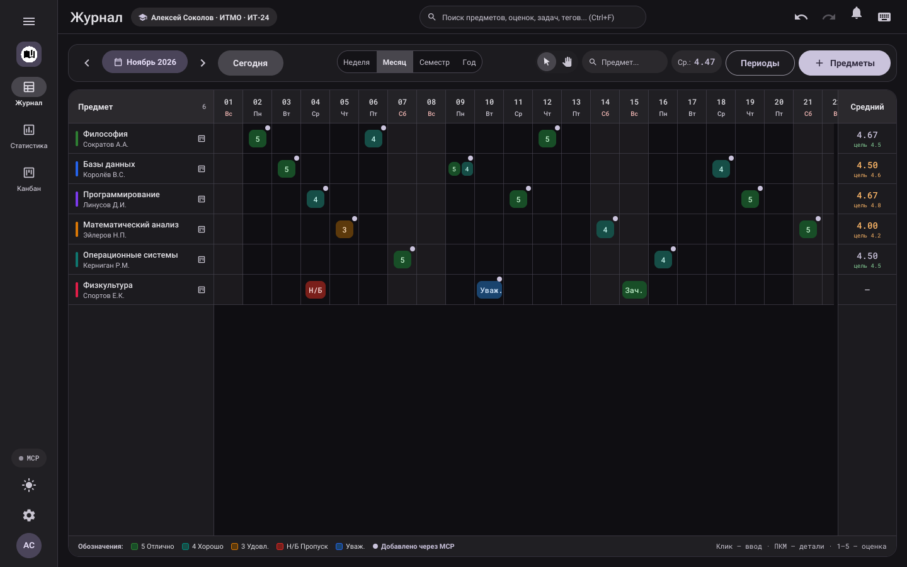
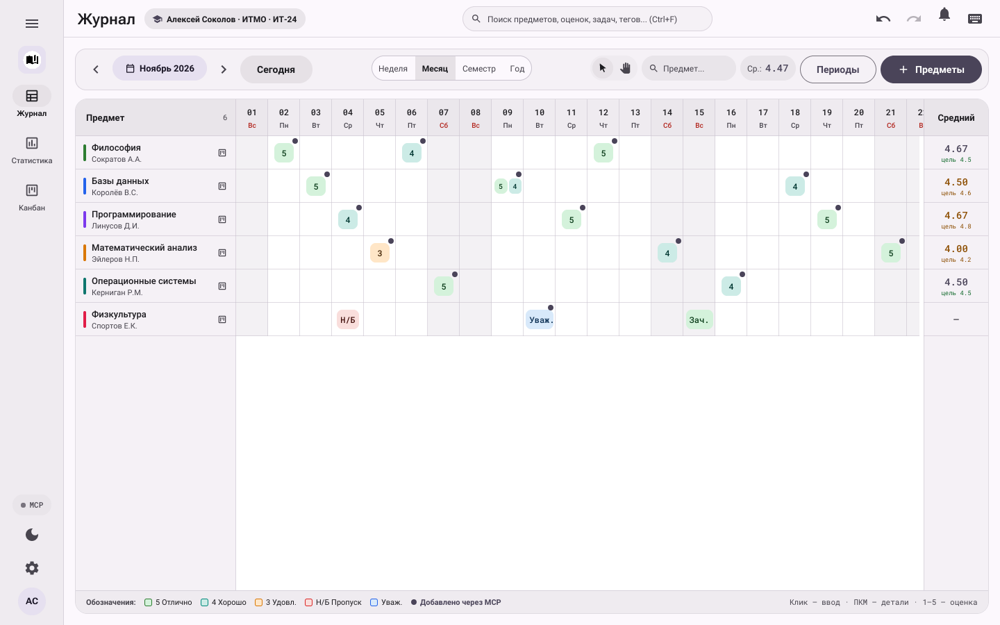
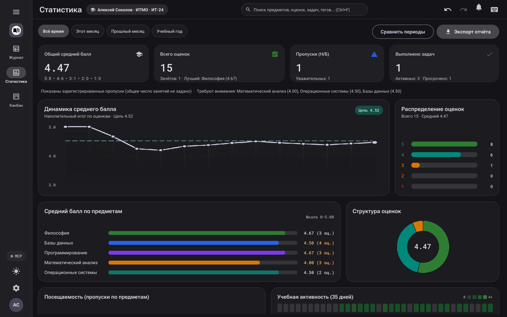
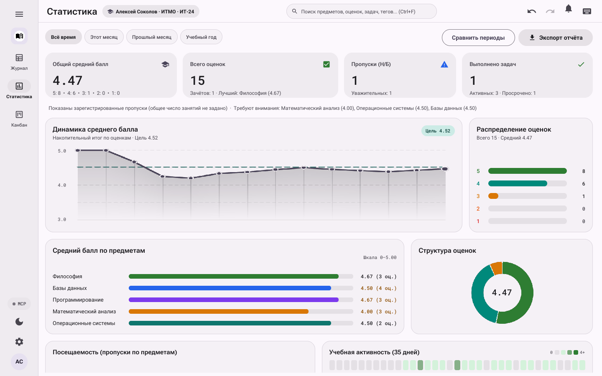
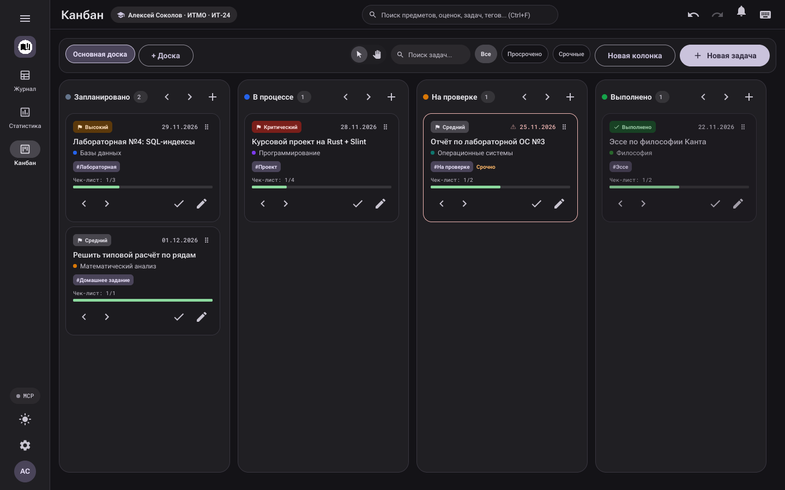
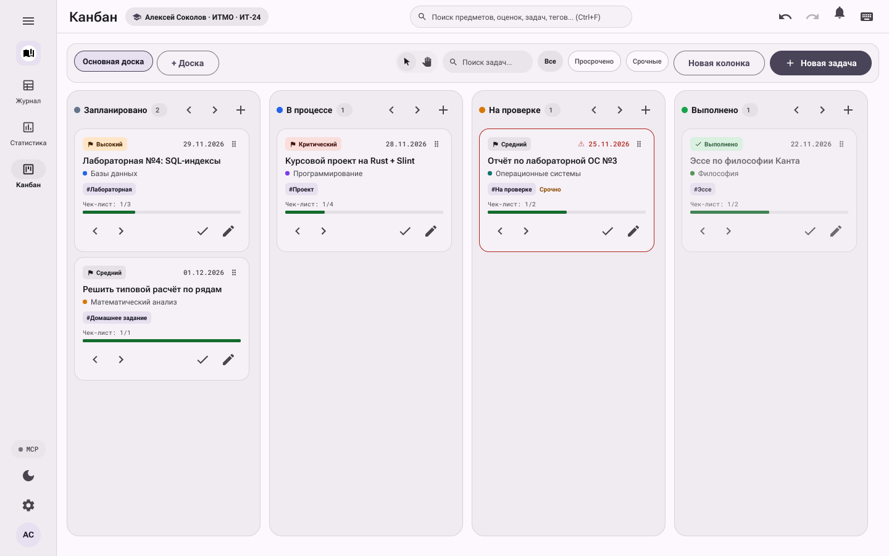
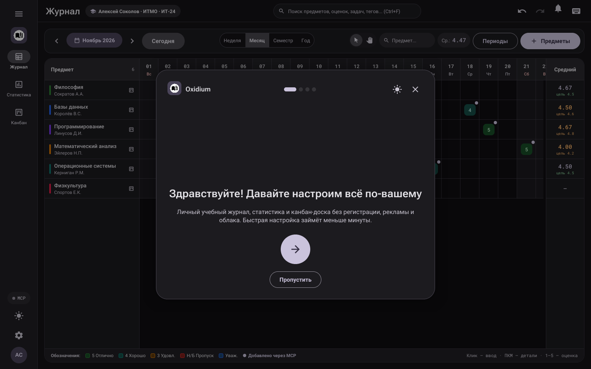
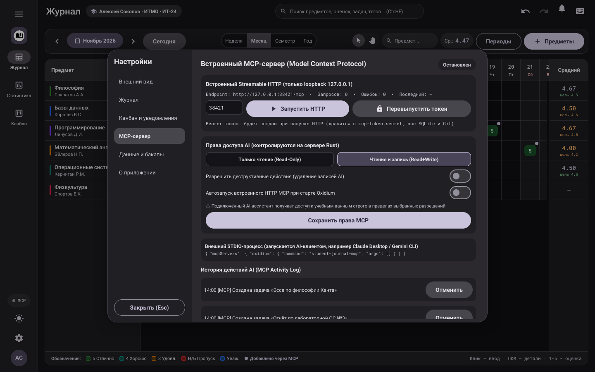

# Oxidium — Student Journal

> Русская версия документации: [README.ru.md](README.ru.md)

**Oxidium** is a free, open-source, local-first, offline-first personal **Student Journal** desktop application built with **Rust**, **Slint (Material Design 3 Expressive)**, **SQLite**, and a full built-in **Model Context Protocol (MCP)** server.

Replace clunky institutional portals, scattered spreadsheets, notes, and Telegram Saved Messages with a fast, native desktop workspace that both you and your AI assistants can use together.

## Screenshots

### Electronic Journal (Dark & Light Themes)



### Statistics & Analytics (Dark & Light Themes)



### Kanban Board (Dark & Light Themes)



### Setup Wizard & Built-in MCP Server Settings



## Highlights

- **Native Desktop Performance**: 100% native Rust + Slint UI (no Electron, Tauri, WebView, or browser runtime). All fonts (`Roboto`, `Roboto Flex`, `Roboto Mono`) and Material Symbols SVG icons are bundled locally — zero CDN requests.
- **Local-First & Offline-First**: Single local SQLite database (`WAL` + `FTS5` + online backup), zero telemetry, zero mandatory registration, zero cloud lock-in.
- **Electronic Journal**: Synchronized pinned top dates header, pinned left subjects column, and pinned right average column; quick grade entry (`1–5`, `Н/Б`, `Уваж.`, `Зач.`, `Н/З`, plus custom mark types); multi-grade cells; exact `rust_decimal` arithmetic & weighted averages; leap-year calendar; and undo/redo.
- **Multi-Profile Isolation**: Independent academic profiles (University, College, School, Online Courses) with isolated subjects, academic periods, grades, attendance, Kanban boards, and statistics.
- **Statistics & Grade Forecast Calculator**: Cumulative GPA line chart, grade breakdown donut chart, 1–5 distribution bar chart, per-subject averages, honest attendance tracking (never fabricating attendance percentages from empty days), 35-day activity heatmap, two-period comparison, and non-destructive exact grade forecasting.
- **Kanban Task Management**: Multiple boards per profile, custom columns with WIP limits and completion flags, drag-and-drop & quick moves, checklists, tags, badges, Markdown notes, deadlines, reminders, and subject/grade links.
- **Production MCP Server (`rmcp 3.11`)**: Both **STDIO** (`student-journal-mcp`) and loopback-only **Streamable HTTP** (`127.0.0.1` + Bearer token auth in `mcp-token.secret`), **80 typed tools**, **6 MCP Resources**, **7 MCP Prompts**, server-side granular permissions (`ReadOnly` / `ReadWrite` / `Destructive`), idempotency keys, AI activity log with Undo, and live cross-process GUI synchronization.

## Verified Release Performance & Sizes (Windows x86_64)

Measured with `cargo build --release --workspace` and `cargo test --release -p journal-app --test perf_benchmarks -- --include-ignored --nocapture`:

| Metric | Measured Result |
| --- | --- |
| `student-journal.exe` (release, stripped, bundled SQLite + fonts/icons) | **38.11 MB** (`39,962,624` bytes) |
| `student-journal-mcp.exe` (release, stripped, standalone MCP server) | **11.88 MB** (`12,453,888` bytes) |
| Windows Portable ZIP / Per-User HKCU Installer | **20.16 MB** / **20.44 MB** |
| Reopen 100,000-grade + 10,000-task SQLite DB | **3.21 ms** |
| Monthly Journal Matrix (100 subjects × 30 days on 10k / 100k grades) | **8.46 ms** / **11.38 ms** |
| Full Statistics (10,000 grades: cold / cached) | **95.19 ms** / **0.13 ms** |
| Full Statistics (100,000 grades: cold / cached) | **1,424.59 ms** / **0.18 ms** |
| FTS5 Russian Search (10k / 100k grades + 10k tasks) | **1.72 ms** / **19.17 ms** |
| Slint UI `refresh_journal` (100 subjects stress test) | **17.06 ms** |

## Building, Testing & Packaging

```sh
# Format, lint, and test the entire workspace
cargo fmt --all -- --check
cargo clippy --workspace --all-targets -- -D warnings
cargo build -p student-journal-mcp
cargo test --workspace

# Security & license audit
cargo audit
cargo deny check

# Run desktop GUI
cargo run -p student-journal

# Run standalone MCP STDIO server
cargo run -p student-journal-mcp

# Build release binaries
cargo build --release --workspace

# Package Windows portable ZIP, per-user HKCU installer, SBOM & SHA-256 checksums
powershell -ExecutionPolicy Bypass -File scripts/package-windows.ps1

# Package Linux tar.gz, .deb, and checksums (on Linux)
bash scripts/package-linux.sh amd64
```

## Documentation

- [Architecture](docs/ARCHITECTURE.md)
- [Database Schema](docs/DATABASE.md)
- [MCP Quickstart](docs/mcp/QUICKSTART.md) | [MCP Tools (80)](docs/mcp/TOOLS.md) | [MCP Security](docs/mcp/SECURITY.md) | [MCP Examples](docs/mcp/EXAMPLES.md)
- [Testing](docs/TESTING.md)
- [Production Readiness Report](PRODUCTION-READINESS-REPORT.md)
- [Security Policy](SECURITY.md)

## License

Oxidium source code is licensed under the MIT License ([LICENSE.txt](LICENSE.txt)). See [THIRD_PARTY_NOTICES.md](THIRD_PARTY_NOTICES.md) for bundled third-party components including Slint, Material Components, Google Fonts (SIL OFL 1.1), and Material Symbols (Apache 2.0).
