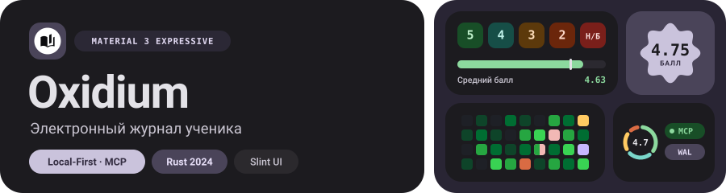
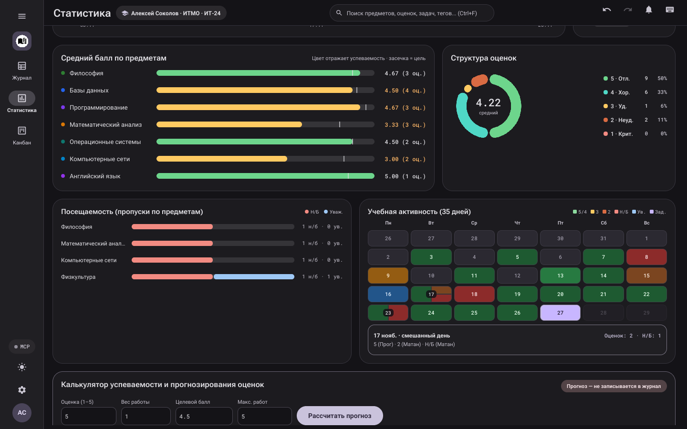

<p align="center">
  <picture>
    <source media="(prefers-color-scheme: dark)" srcset="docs/assets/banner-dark.svg">
    <source media="(prefers-color-scheme: light)" srcset="docs/assets/banner-light.svg">
    
  </picture>
</p>

<p align="center">
  <sub><code>RUST · SLINT M3 EXPRESSIVE · SQLITE · MCP</code></sub><br>
  <sub><b>Русский</b> · <a href="README.en.md">English</a></sub>
</p>

<p align="center">
  <b>Личный электронный журнал ученика нового поколения.</b><br>
  Оценки, аналитика, канбан-задачи и AI-помощник через MCP — быстро, локально и без браузера.
</p>

<p align="center">
  <a href="https://github.com/cryals/Oxidium/releases/latest">
    <picture>
      <source media="(prefers-color-scheme: dark)" srcset="docs/assets/badges/cta-download-dark.svg">
      <source media="(prefers-color-scheme: light)" srcset="docs/assets/badges/cta-download-light.svg">
      
    </picture>
  </a>
  <a href="docs/mcp/QUICKSTART.md">
    <picture>
      <source media="(prefers-color-scheme: dark)" srcset="docs/assets/badges/cta-mcp-dark.svg">
      <source media="(prefers-color-scheme: light)" srcset="docs/assets/badges/cta-mcp-light.svg">
      
    </picture>
  </a>
  <a href="CHANGELOG.md">
    <picture>
      <source media="(prefers-color-scheme: dark)" srcset="docs/assets/badges/cta-changelog-dark.svg">
      <source media="(prefers-color-scheme: light)" srcset="docs/assets/badges/cta-changelog-light.svg">
      
    </picture>
  </a>
</p>

<p align="center">
  <picture>
    <source media="(prefers-color-scheme: dark)" srcset="docs/assets/badges/chip-rust-dark.svg">
    <source media="(prefers-color-scheme: light)" srcset="docs/assets/badges/chip-rust-light.svg">
    
  </picture>
  <picture>
    <source media="(prefers-color-scheme: dark)" srcset="docs/assets/badges/chip-slint-dark.svg">
    <source media="(prefers-color-scheme: light)" srcset="docs/assets/badges/chip-slint-light.svg">
    
  </picture>
  <picture>
    <source media="(prefers-color-scheme: dark)" srcset="docs/assets/badges/chip-sqlite-dark.svg">
    <source media="(prefers-color-scheme: light)" srcset="docs/assets/badges/chip-sqlite-light.svg">
    
  </picture>
  <picture>
    <source media="(prefers-color-scheme: dark)" srcset="docs/assets/badges/chip-mcp-dark.svg">
    <source media="(prefers-color-scheme: light)" srcset="docs/assets/badges/chip-mcp-light.svg">
    
  </picture>
  <picture>
    <source media="(prefers-color-scheme: dark)" srcset="docs/assets/badges/chip-platforms-dark.svg">
    <source media="(prefers-color-scheme: light)" srcset="docs/assets/badges/chip-platforms-light.svg">
    
  </picture>
</p>

<p align="center">
  <a href="https://github.com/cryals/Oxidium/actions/workflows/ci.yml"></a>
  <a href="https://github.com/cryals/Oxidium/releases/latest"></a>
  <a href="https://github.com/cryals/Oxidium/releases"></a>
  <a href="LICENSE.txt"></a>
</p>

**Oxidium** заменяет неудобные школьные и вузовские порталы, разрозненные таблицы и «Избранное» в Telegram единым нативным рабочим пространством. Все данные хранятся на вашем компьютере в SQLite, а встроенный MCP-сервер позволяет вести журнал и задачи как вручную, так и через AI-ассистентов.

## Быстрый старт

1. Откройте [страницу релизов](https://github.com/cryals/Oxidium/releases/latest) и скачайте сборку для своей системы (`setup.exe` или `portable.zip` для Windows x64; `.deb`, `.AppImage` или `.tar.gz` для Linux).
2. На Windows запустите установщик — установка проходит в папку пользователя (`%LOCALAPPDATA%\Programs\Oxidium`) без прав администратора и UAC.
3. При первом запуске пройдите быстрый мастер настройки: выберите тему (тёмная, светлая или системная), язык (`ru` / `en`) и создайте учебный профиль.
4. Далее приложение само уведомит о выходе новых версий на GitHub Releases и позволит обновиться с проверкой `SHA256SUMS.txt`.

## Интерфейс

<table>
  <tr>
    <td width="50%" align="center">
      <picture>
        <source media="(prefers-color-scheme: dark)" srcset="docs/screenshots/journal-dark.png">
        <source media="(prefers-color-scheme: light)" srcset="docs/screenshots/journal-light.png">
        
      </picture><br>
      <sub><b>Электронный журнал</b> — закреплённые колонки, быстрый ввод и несколько оценок в ячейке</sub>
    </td>
    <td width="50%" align="center">
      <picture>
        <source media="(prefers-color-scheme: dark)" srcset="docs/screenshots/statistics-dark.png">
        <source media="(prefers-color-scheme: light)" srcset="docs/screenshots/statistics.png">
        
      </picture><br>
      <sub><b>Статистика</b> — динамика среднего балла, структура оценок, предметы и прогноз</sub>
    </td>
  </tr>
  <tr>
    <td width="50%" align="center">
      <picture>
        <source media="(prefers-color-scheme: dark)" srcset="docs/screenshots/kanban-dark.png">
        <source media="(prefers-color-scheme: light)" srcset="docs/screenshots/kanban.png">
        
      </picture><br>
      <sub><b>Канбан-доска</b> — доски, WIP-лимиты, чек-листы, дедлайны и теги</sub>
    </td>
    <td width="50%" align="center">
      <br>
      <sub><b>MCP-сервер</b> — HTTP-порт 127.0.0.1, Bearer-токен, права AI и журнал действий с Undo</sub>
    </td>
  </tr>
</table>

<details>
<summary>Дополнительные экраны: тепловая карта активности, мастер настройки и окно обновлений</summary>
<br>
<table>
  <tr>
    <td width="33%" align="center">
      <br>
      <sub>Тепловая карта 5×7 и прогноз оценок</sub>
    </td>
    <td width="33%" align="center">
      <br>
      <sub>Мастер первоначальной настройки</sub>
    </td>
    <td width="33%" align="center">
      <br>
      <sub>Проверка SHA-256 и автообновление</sub>
    </td>
  </tr>
</table>
</details>

## Возможности

<table>
  <tr>
    <td><b>Журнал</b></td>
    <td>Синхронизированные закреплённые шапка дат, список предметов и колонка среднего; быстрый ввод <code>1–5</code>, <code>Н/Б</code>, <code>Уваж.</code>, <code>Зач.</code>, <code>Н/З</code> и своих отметок; мульти-ячейки; точная математика на <code>rust_decimal</code> и отмена/повтор (<code>Undo/Redo</code>).</td>
  </tr>
  <tr>
    <td><b>Аналитика</b></td>
    <td>Сглаженный график динамики среднего балла с целевой линией, кольцевая диаграмма структуры, распределение <code>1–5</code>, средние по предметам, честный учёт пропусков, мозаичная тепловая карта 35 дней, сравнение периодов и калькулятор прогноза.</td>
  </tr>
  <tr>
    <td><b>Канбан</b></td>
    <td>Несколько досок в профиле, гибкие колонки с WIP-лимитами и флагом завершения, перетаскивание и быстрые переходы, чек-листы, приоритеты, теги, бейджи, Markdown-заметки, напоминания и привязка к предметам и оценкам.</td>
  </tr>
  <tr>
    <td><b>Профили</b></td>
    <td>Изолированные учебные контексты (Университет, Колледж, Школа, Курсы) со своими предметами, учебными периодами, оценками, канбан-досками, бэкапами (SQLite Online Backup) и экспортом в CSV / JSON / XLSX.</td>
  </tr>
  <tr>
    <td><b>Дизайн M3</b></td>
    <td>Нативный интерфейс <b>Slint Material Design 3 Expressive</b>: spring-анимации, адаптивная сетка от <code>800×560</code>, тёмная и светлая схемы, настраиваемый акцент, компактный режим, горячие клавиши и встроенные шрифты/иконки без обращений к CDN.</td>
  </tr>
  <tr>
    <td><b>MCP и AI</b></td>
    <td>Встроенный сервер на <code>rmcp 3.11</code>: <b>80 типизированных инструментов</b>, <b>6 ресурсов</b> и <b>7 промптов</b>, права <code>ReadOnly</code> / <code>ReadWrite</code> / <code>Destructive</code>, ключи идемпотентности, Undo для действий AI и живая синхронизация с открытым окном.</td>
  </tr>
</table>

## Подключение AI (MCP)

Oxidium работает с Claude Desktop, Claude Code, Gemini CLI, Codex и любым MCP-совместимым клиентом через **STDIO** (`student-journal-mcp`) или встроенный **Streamable HTTP** (`127.0.0.1:38421/mcp` с Bearer-токеном в `mcp-token.secret`).

```json
{
  "mcpServers": {
    "oxidium": {
      "command": "student-journal-mcp",
      "args": []
    }
  }
}
```

- При установке на Windows бинарник расположен в `%LOCALAPPDATA%\Programs\Oxidium\student-journal-mcp.exe`.
- Изменения от внешнего AI-клиента отображаются в открытом GUI в пределах ~0.5 с без перезапуска.
- Подробнее о настройке, правах доступа и примерах запросов — в [быстром старте MCP](docs/mcp/QUICKSTART.md) и [справочнике 80 инструментов](docs/mcp/TOOLS.md).

## Производительность

Замеры выполнены на release-сборке (`v0.1.3`, Windows x86_64) и стресс-тестах `perf_benchmarks` на базе до **100 000 оценок** и **10 000 задач**:

| Показатель | Результат |
| --- | --- |
| `student-journal.exe` / `student-journal-mcp.exe` (`v0.1.3`, stripped release) | **43.95 МБ** / **11.92 МБ** |
| Установщик Windows (HKCU, без UAC) / Portable ZIP (`v0.1.3`) | **22.14 МБ** / **21.82 МБ** |
| Открытие базы со 100 000 оценок и 10 000 задач | **3.21 мс** |
| Матрица журнала (100 предметов × 30 дней при 10k / 100k оценок) | **8.46 мс** / **11.38 мс** |
| Полная статистика (10k оценок: холодный расчёт / кэш) | **95.19 мс** / **0.13 мс** |
| Полнотекстовый поиск FTS5 на русском (10k / 100k оценок + 10k задач) | **1.72 мс** / **19.17 мс** |
| Обновление UI `refresh_journal` на 100 предметах | **17.06 мс** |

## Разработка и проверки

Понадобится **Rust 1.95+** (Edition 2024).

```powershell
git clone https://github.com/cryals/Oxidium.git
cd Oxidium

# Запуск настольного приложения и автономного MCP-сервера
cargo run -p student-journal
cargo run -p student-journal-mcp
```

<details>
<summary>Системные зависимости для сборки на Linux (Ubuntu / Debian)</summary>

```sh
sudo apt-get update
sudo apt-get install -y libfontconfig1-dev libfreetype6-dev libxkbcommon-dev \
  libwayland-dev libxcb-shape0-dev libxcb-xfixes0-dev libdbus-1-dev libssl-dev pkg-config
```

</details>

```sh
# Форматирование, линтер, тесты и аудит безопасности/лицензий
cargo fmt --all -- --check
cargo clippy --workspace --all-targets -- -D warnings
cargo test --workspace
cargo audit
cargo deny check

# Сборка release и упаковка дистрибутива (Windows / Linux)
cargo build --release --workspace
powershell -ExecutionPolicy Bypass -File scripts/package-windows.ps1
bash scripts/package-linux.sh amd64
```

## Документация

[Архитектура](docs/ARCHITECTURE.md) · [Схема БД](docs/DATABASE.md) · [Быстрый старт MCP](docs/mcp/QUICKSTART.md) · [80 инструментов MCP](docs/mcp/TOOLS.md) · [Безопасность MCP](docs/mcp/SECURITY.md) · [Примеры AI-сценариев](docs/mcp/EXAMPLES.md) · [Тестирование](docs/TESTING.md) · [Список изменений](CHANGELOG.md) · [Дорожная карта](ROADMAP.md)

## Стек

Rust 2024 · Slint UI (Material Design 3 Expressive) · SQLite (`rusqlite` + WAL + FTS5) · `rust_decimal` · `rmcp 3.11` · `axum` · `tokio`

## Лицензия

Исходный код **Oxidium** распространяется под лицензией **MIT** ([LICENSE.txt](LICENSE.txt)). Сведения о лицензиях встроенных компонентов (`Slint`, `Material Components`, шрифты Google Fonts `SIL OFL 1.1`, `Material Symbols Apache 2.0`) приведены в [THIRD_PARTY_NOTICES.md](THIRD_PARTY_NOTICES.md).
