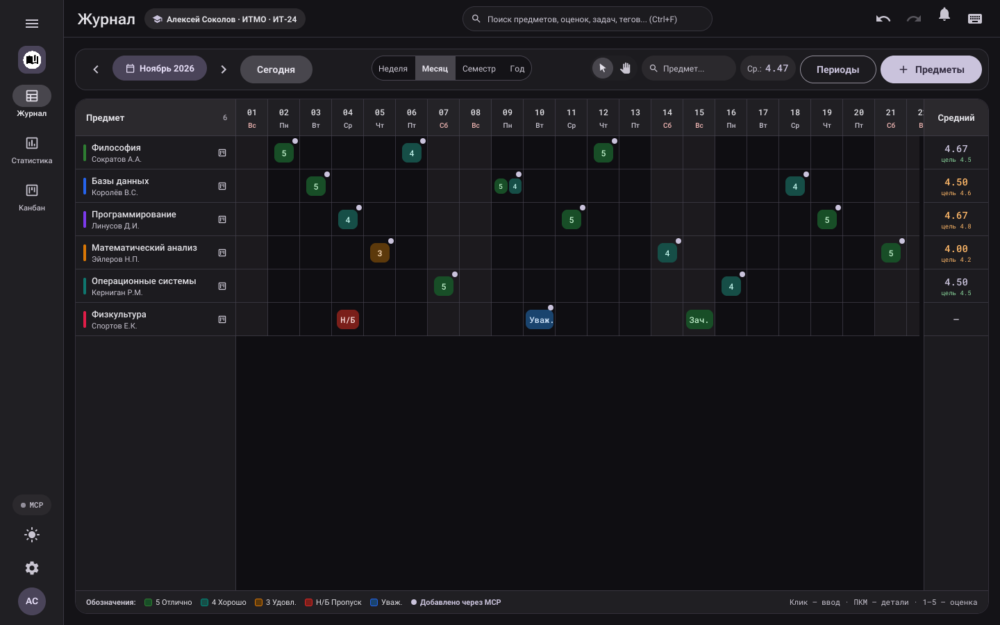
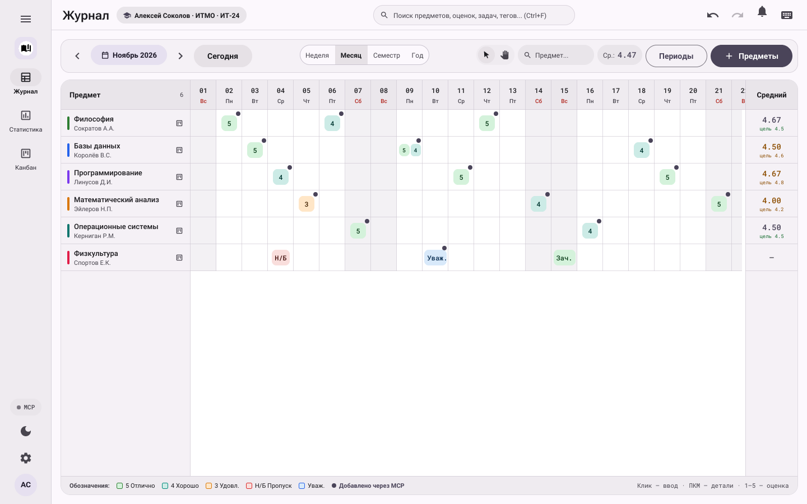
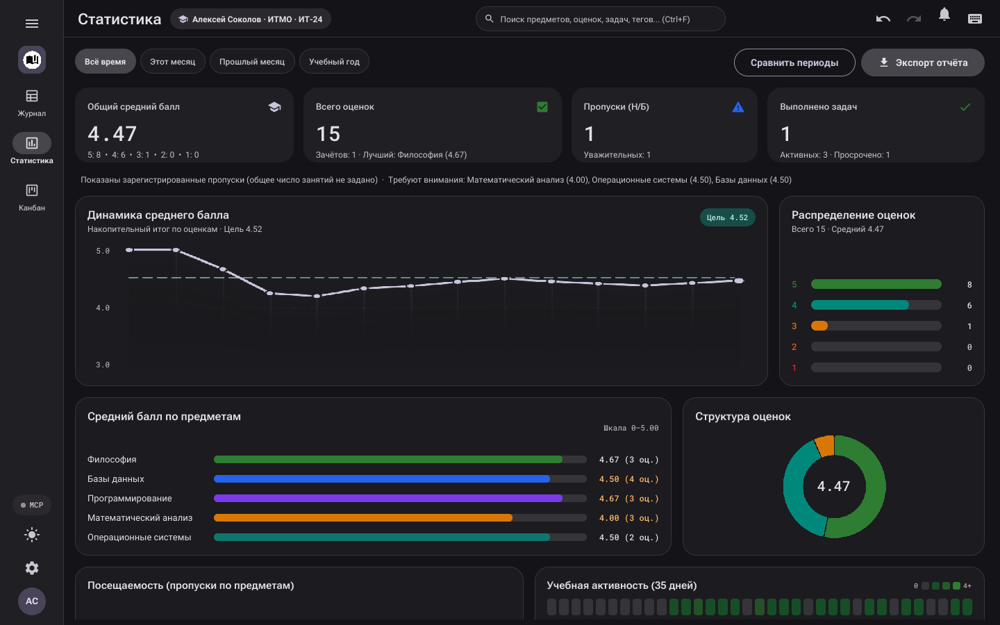
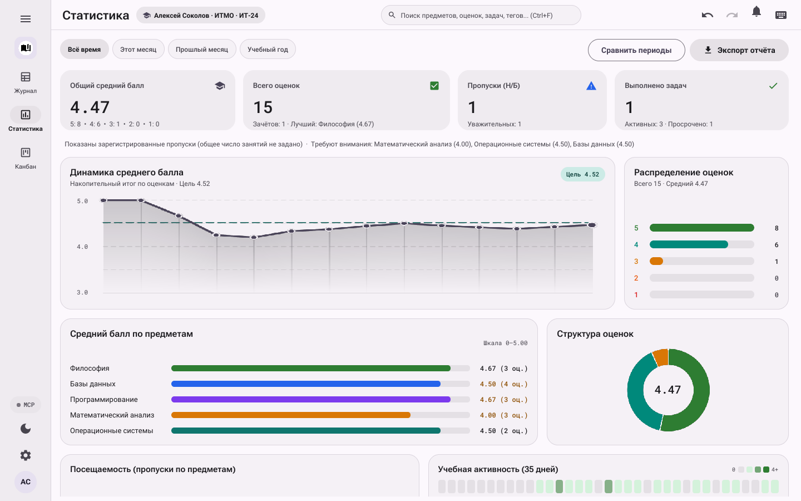
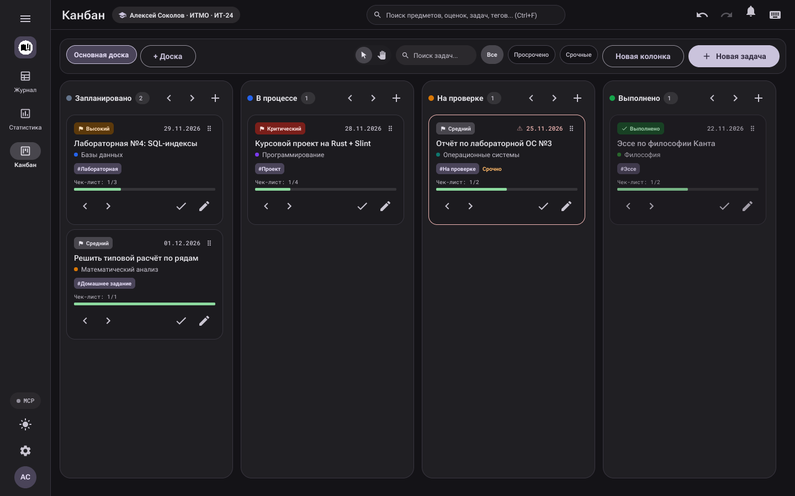
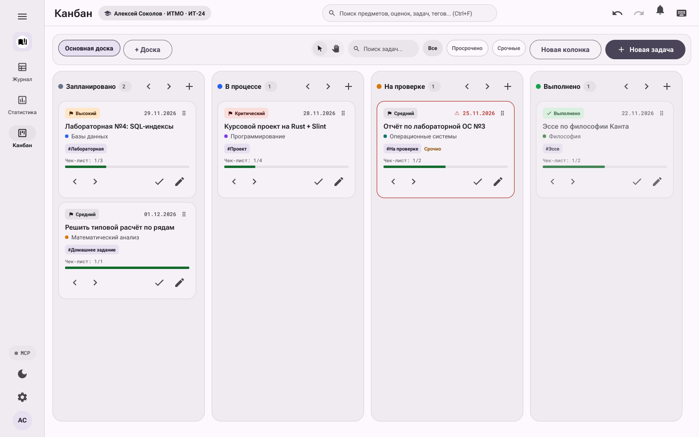
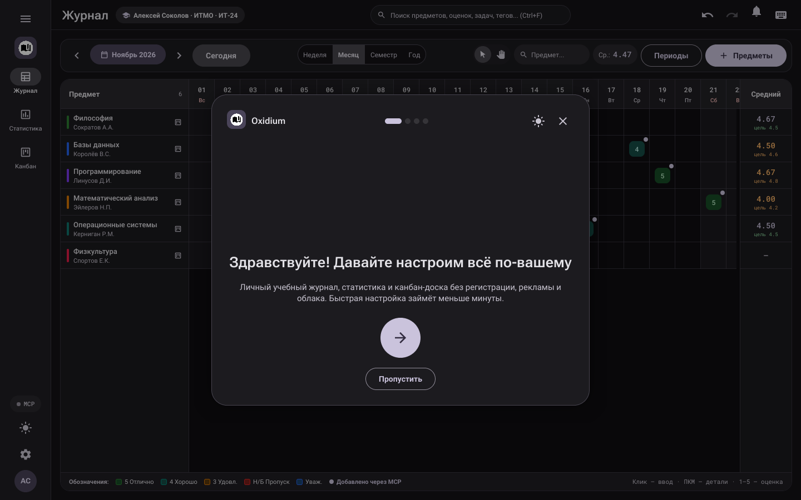
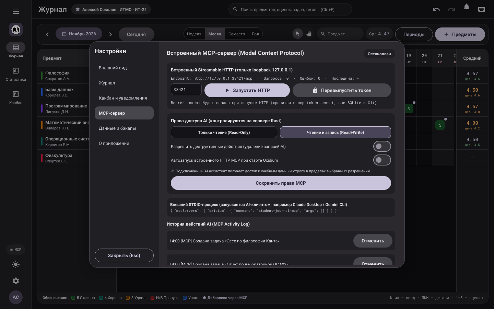

# Oxidium — Электронный журнал ученика

> English documentation: [README.md](README.md)

**Oxidium** — бесплатное open-source, local-first и offline-first десктопное приложение **«Электронный журнал ученика»**, написанное на **Rust** с нативным интерфейсом **Slint (Material Design 3 Expressive)**, локальной базой **SQLite** и полноценным встроенным **MCP-сервером (Model Context Protocol)**.

Приложение заменяет неудобные электронные журналы, разрозненные таблицы, заметки и «Избранное» в Telegram, позволяя вести учёт успеваемости, посещаемости и учебных задач как вручную, так и через AI-ассистентов на естественном языке.

## Скриншоты интерфейса

### Электронный журнал (тёмная и светлая темы)



### Статистика и аналитика (тёмная и светлая темы)



### Канбан-доска (тёмная и светлая темы)



### Мастер быстрой настройки и встроенный MCP-сервер



## Ключевые возможности

- **Нативный интерфейс на Rust + Slint**: без Electron, Tauri, WebView и браузерных движков; все шрифты (`Roboto`, `Roboto Flex`, `Roboto Mono`) и иконки Material Symbols встроены локально без обращений к CDN.
- **Приватность и Local-First**: все данные хранятся локально в SQLite (`WAL`, `FTS5`, онлайн-резервное копирование), без облаков, регистрации, рекламы и телеметрии.
- **Электронный журнал**: синхронизированные закреплённые шапка дат, колонка предметов и колонка среднего балла; быстрый ввод отметок (`1–5`, `Н/Б`, `Уваж.`, `Зач.`, `Н/З` и пользовательские типы); несколько оценок в одной ячейке; точный расчёт обычного и взвешенного среднего (`rust_decimal`); високосные годы и отмена/повтор.
- **Независимые профили**: Университет, Колледж, Школа, Онлайн-курсы с полной изоляцией предметов, учебных периодов, оценок, посещаемости, канбана и статистики.
- **Статистика и калькулятор прогноза**: график динамики среднего балла, кольцевая диаграмма структуры оценок, распределение `1–5`, средние по предметам, честная посещаемость без выдуманных процентов, тепловая карта активности за 35 дней, сравнение двух периодов и точный неразрушающий прогноз оценок.
- **Канбан-доска**: несколько досок в профиле, гибкие колонки с WIP-лимитами и флагом завершения, перемещение карточек, чек-листы, теги, бейджи, Markdown-заметки, дедлайны, уведомления и связь задач с предметами и оценками.
- **Встроенный MCP-сервер (`rmcp 3.11`)**: транспорты **STDIO** (`student-journal-mcp`) и локальный **Streamable HTTP** (`127.0.0.1` + Bearer-токен в `mcp-token.secret`), **80 типизированных инструментов**, **6 MCP Resources**, **7 MCP Prompts**, серверный контроль прав (`ReadOnly` / `ReadWrite` / `Destructive`), идемпотентность, журнал действий AI с отменой и живая синхронизация с открытым GUI.

## Подтверждённые показатели производительности (Release, Windows x86_64)

Замеры выполнены на реальной сборке `cargo build --release --workspace` и `cargo test --release -p journal-app --test perf_benchmarks -- --include-ignored --nocapture`:

| Показатель | Измеренный результат |
| --- | --- |
| `student-journal.exe` (release, stripped, встроенный SQLite + шрифты/иконки) | **38.11 МБ** (`39 962 624` байт) |
| `student-journal-mcp.exe` (release, stripped, автономный MCP-сервер) | **11.88 МБ** (`12 453 888` байт) |
| Портативный ZIP / Установщик Windows (HKCU, без UAC) | **20.16 МБ** / **20.44 МБ** |
| Повторное открытие БД со 100 000 оценок и 10 000 задач | **3.21 мс** |
| Построение матрицы месяца (100 предметов × 30 дней при 10k / 100k оценок) | **8.46 мс** / **11.38 мс** |
| Полная статистика (10 000 оценок: холодная / из кэша) | **95.19 мс** / **0.13 мс** |
| Полная статистика (100 000 оценок: холодная / из кэша) | **1 424.59 мс** / **0.18 мс** |
| Полнотекстовый поиск FTS5 на русском (10k / 100k оценок + 10k задач) | **1.72 мс** / **19.17 мс** |
| Обновление UI `refresh_journal` на 100 предметах | **17.06 мс** |

## Сборка, проверка и упаковка

```sh
# Проверка форматирования, линтера и всех тестов
cargo fmt --all -- --check
cargo clippy --workspace --all-targets -- -D warnings
cargo build -p student-journal-mcp
cargo test --workspace

# Аудит уязвимостей и лицензий
cargo audit
cargo deny check

# Запуск десктопного GUI
cargo run -p student-journal

# Запуск автономного MCP-сервера (STDIO)
cargo run -p student-journal-mcp

# Release-сборка
cargo build --release --workspace

# Сборка портативного ZIP, установщика Windows, SBOM и SHA-256
powershell -ExecutionPolicy Bypass -File scripts/package-windows.ps1

# Сборка Linux .tar.gz и .deb (на Linux)
bash scripts/package-linux.sh amd64
```

## Документация

- [Архитектура](docs/ARCHITECTURE.md)
- [Схема базы данных](docs/DATABASE.md)
- [Быстрый старт MCP](docs/mcp/QUICKSTART.md) | [Справочник 80 инструментов](docs/mcp/TOOLS.md) | [Безопасность MCP](docs/mcp/SECURITY.md) | [Примеры диалогов](docs/mcp/EXAMPLES.md)
- [Тестирование](docs/TESTING.md)
- [Отчёт готовности к production](PRODUCTION-READINESS-REPORT.md)
- [Политика безопасности](SECURITY.md)

## Лицензия

Исходный код Oxidium распространяется под лицензией MIT ([LICENSE.txt](LICENSE.txt)). Сведения о лицензиях сторонних компонентов (Slint, Material Components, шрифты Google Fonts SIL OFL 1.1, иконки Material Symbols Apache 2.0) приведены в [THIRD_PARTY_NOTICES.md](THIRD_PARTY_NOTICES.md).
